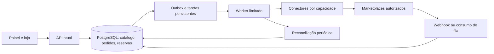

# Central comercial multicanal — auditoria e plano para aprovação

Data: 11/10/2026. Base auditada: `417b6b4`, branch `main`. Estado: proposta, sem implementação de integrações nem alterações de produção. O pedido exige aprovação deste plano antes da implementação.

## 1. Conclusão e limites da auditoria

A aplicação tem uma base comercial reaproveitável, mas ainda não é um hub integrado. Não existe hoje conector operacional de marketplace. A seção Canais persiste registros internos; Mercado Livre é um esqueleto e Shopee/Amazon caem no adaptador manual. A prioridade é corrigir a consistência transacional e distinguir controle manual de confirmação externa, antes de automatizar operações comerciais.

Foram examinados schema Prisma, serviços, repositórios, controllers e rotas de catálogo/canais/pedidos/vendas, autenticação, permissões compartilhadas, telas administrativas, componentes reutilizáveis, configuração de contêineres e cobertura de integração existente. A auditoria é de código e documentação pública: não foram acessadas contas privadas de marketplaces, realizadas vendas, alterados estoques ou executadas chamadas comerciais. Fluxos existentes têm testes no repositório e validações anteriores; esta auditoria não equivale à certificação ponta a ponta de todos eles. Limites de contas e homologações continuam pendentes.

## 2. O que existe e será reaproveitado

| Área | Evidência no repositório | Situação e evolução |
| --- | --- | --- |
| Catálogo | `Product`, `Category`, `ProductImage`; `product.service.ts` | CRUD, SKU, preço, estoque inteiro, peso, dimensões em texto, imagens locais. Evoluir atributos estruturados, GTIN/marca, variantes, unidades e dados fiscais/logísticos. |
| Campanhas | `Promotion`, `PromotionProduct`, `promotion.service.ts` | Campanhas, vigência e regras promocionais locais. Não equivalem a campanhas externas; adaptar por capacidade. |
| Pedidos | `CustomerOrder`, `CustomerOrderItem`, `order.service.ts` | Checkout com identificação, snapshots e encaminhamento WhatsApp. Não é checkout com captura de pagamento nem expedição. |
| Vendas e estoque | `Sale`, `SaleItem`, `StockMovement`, `sale.repository.ts` | Registro, faturamento, baixa e estorno locais. Precisa de concorrência, reservas e idempotência antes de multicanal. |
| CRM | `User`, `CustomerNote`, `customer.service.ts` | Histórico, estágios, notas e follow-up. Compradores de marketplace não devem ser cadastrados automaticamente como usuários com acesso. |
| Orçamentos | `QuoteRequest`, `QuoteItem`, `OcrRun` | Wizard autenticado, foto/recorte, IA externa, revisão e histórico. Preservar; não usar IA para cada sincronização. |
| Canais | `Channel`, `ChannelListing`, `channel.service.ts` | Credenciais cifradas, vínculos/snapshots, sincronização solicitada na requisição. Sem OAuth, importação de pedidos, worker, webhook ou reconciliação operacional. |
| Permissões | `constants/access.ts`, middleware e rotas | ADMIN, MANAGER, CATALOG_MANAGER, MARKETING, SALES, CUSTOMER. Expandir capacidades; credenciais e financeiro não devem ficar disponíveis a vendedores. |
| Segurança | `auth.middleware.ts`, `crypto.util.ts` | Sessão com usuário ativo/role atual, cookies HttpOnly, AES-256-GCM para segredos. Reutilizar e complementar renovação, auditoria e proteção de eventos. |
| Interface | `DashboardElements`, componentes de painel e wizard | Identidade e elementos compartilhados. Evoluir filas por tarefa, ações em lote e mensagens curtas. |
| Infraestrutura | `docker-compose.production.yml`, workflow e scripts | PostgreSQL 16, API Node/Express/Prisma, React/Vite, uploads persistentes, GHCR, GitHub Actions, verificações de restauração/rollback. Manter um workflow e builds paralelos. |

## 3. Lacunas e riscos concretos

1. **Concorrência de baixa:** `resolveItems` lê estoque antes de `createSaleWithStock`; o repositório grava `stockBefore - quantity` como valor absoluto. Duas vendas podem aprovar o mesmo saldo e uma sobrescrever a baixa da outra. Transação, sozinha, não resolve isso.
2. **Estorno não atômico com status:** `restockCanceledSale` e atualização do status ocorrem separadamente. Cancelamentos simultâneos/repetidos podem duplicar devolução; reabrir venda cancelada também exige regra explícita de nova reserva/baixa.
3. **Pedido não reserva:** checkout verifica saldo, mas não mantém reserva. Dois pedidos podem disputar os mesmos itens. Orçamento não deve reservar automaticamente; pedido precisa de política de reserva/expiração definida.
4. **Falsa percepção de integração:** Shopee e Amazon recebem `ok: true` do adaptador manual; snapshots ficam `SYNCED` sem confirmação externa. A interface também classifica Mercado Livre como automatizado, embora suas chamadas retornem não implementado. Cadastrar credenciais já marca `CONNECTED`, sem validar conta.
5. **Perda de vínculo:** `removeListing` ignora resultado negativo do adaptador e apaga o vínculo local; `deleteChannel` elimina registros relacionados. Preservar histórico e confirmação externa antes de arquivar.
6. **Publicação vulnerável a duplicação:** chamada externa precede criação do vínculo. Requisições concorrentes ou crash entre as etapas podem publicar duas vezes ou deixar anúncio sem vínculo. Uma restrição local não desfaz publicação remota.
7. **Propagação incompleta:** venda marca anúncios defasados em best-effort; atualização/exclusão do produto não passa pelo mesmo mecanismo. Falha pós-venda pode perder a necessidade de atualização. Não há outbox transacional.
8. **Sincronização limitada:** `syncChannel` processa até 500 vínculos sequencialmente em uma requisição HTTP. Sem paginação integral, checkpoint, limite por operação, retry persistente ou recuperação após restart.
9. **Contrato insuficiente:** snapshot do adaptador só leva nome, SKU, preço, estoque e descrição; faltam imagens, categorias externas, atributos, variantes, dimensões estruturadas e restrições. `removeListing` mistura pausar, fechar e excluir.
10. **Modelo comercial incompleto:** valores monetários Float, sem custo por item, taxas reais, liquidação, frete, devolução parcial, nota fiscal, endereço de entrega, pacotes ou identificadores externos de pedido.
11. **Uma instalação/loja:** não há isolamento por organização/tenant no modelo atual. Este plano cobre a Rebequi com várias contas/canais; vender como SaaS para várias empresas exige fase própria de isolamento, faturamento e autorização por organização.
12. **Dados e catálogo:** fotos geradas são ilustrativas; não devem ser automaticamente publicadas como representação oficial de um produto real sem conferência. Ferramentas, cimento, tintas e materiais pesados exigem validação de categoria, dimensões, restrições de transporte e área atendida.

Esses são achados de código, não alegações de incidentes ocorridos em produção. Testes atuais concentram-se em sessão, orçamento, mídia e interface; faltam provas de concorrência comercial e operações reais de marketplace.

## 4. Pesquisa de canais: confirmado versus pendente

Fontes oficiais consultadas em 11/10/2026. Documentação pública prova existência de recursos, não sua liberação para a conta do cliente. Cada ação depende de escopo, modalidade logística, categoria, status e aprovação. Não usar scraping nem automação do painel como substituto de API.

| Canal | Recursos documentados | Entrada e autorização | Pendências e operações fora da plataforma |
| --- | --- | --- | --- |
| Mercado Livre | Publicação, User Products, preço/estoque por modelo/localização, pedidos e notificações. | Aplicação e consentimento do vendedor; implementar OAuth e renovação antes de operar. | Checar modelo habilitado na conta; não limitar conector ao PUT legado de available_quantity. Configuração de depósitos pode exigir painel. Ações pós-venda, etiquetas, mensagens e cancelamentos precisam de validação específica. |
| Shopee | Portal oficial identificado, mas documentação devolveu 403 na pesquisa. | Cadastro/acesso ao Open Platform e validação do processo vigente para Brasil. | **Não confirmado nesta auditoria:** lista exata de endpoints, escopos, webhook, homologação, SLA, logística e devoluções. Nenhuma promessa de integração completa até obter acesso oficial autorizado. |
| Amazon | SP-API, catálogo/listings, pedidos, notificações e APIs separadas de operação; roles e limites por operação. Brasil pertence ao endpoint da América do Norte. | Registro de desenvolvedor, aplicação privada/pública conforme uso e autorização do seller; aprovação das roles necessárias. | Notificações podem usar SQS/EventBridge, não webhook HTTP genérico. Dados pessoais exigem permissões aplicáveis. FBA não é saldo físico compartilhado da loja; expedição/retorno dependem da modalidade. Sandbox não prova todos os comportamentos reais. |
| Magalu | Produtos/preço/estoque, pedidos/entregas, SAC, perguntas, chat, webhooks e domínios financeiros no portal. | Cliente ID Magalu, OAuth Authorization Code, escopos e consentimento de loja PJ. | Confirmar endpoints/scopes e canal efetivamente habilitado. O portal geral menciona empresas do grupo, mas a página de pedidos delimita disponibilidade; não assumir Netshoes/Kabum com os mesmos recursos. |
| Casas Bahia | Produtos/ofertas, estoque, preço, status, pedidos, etiquetas/tracking, frete e SAC. | client_id + token; testes em HLG e homologação antes de PRD. | Certificação e condições de token por seller; validação detalhada de notificações e pós-venda. Não tratar autenticação como OAuth genérico. |
| Americanas | SkyHub documenta produtos e pedidos, consulta/fila e faturamento em modalidades específicas. | Credenciais da conta e identificação de integradora (`x-accountmanager-key`), processo de homologação. | Confirmar acesso comercial vigente do seller, SLA da fila e recursos pós-venda. Confirmar persistência local antes do ACK/remoção da fila; não supor que DELETE de fila cancele o pedido. |
| SHEIN | Plataforma publica produtos, Feed API/estoque, pedidos, logística e notificações; revisão de aplicação e autorização. | Conta de plataforma, criação/revisão de app e autorização de loja. | Operações variam entre POP, self-operated, semi/fully managed e país; validar categoria brasileira. Página de pedido informa ausência de consulta de comentários/mensagens. Não prometer caixa de entrada universal. |
| TikTok Shop | Partner Center documenta famílias de APIs de produto/pedido/logística/reversa/webhook; há documentos específicos do mercado BR. | App de TikTok Shop Partner Center e autorização da loja; não confundir com API de postagem de vídeos. | Canal adicional condicional à elegibilidade do catálogo, autorização BR e testes; prioridades após os canais principais. |

### Fontes oficiais e o que sustentam

- Mercado Livre: [User Products](https://developers.mercadolivre.com.br/pt_br/user-products), [estoque multi-origem](https://developers.mercadolivre.com.br/pt_br/estoque-multi-origem), [publicação](https://developers.mercadolivre.com.br/pt_br/autenticacao-e-autorizacao/publicacao-de-produtos), [notificações](https://developers.mercadolivre.com.br/en_us/products-receive-notifications). O conteúdo indexado dessas páginas foi consultado; abertura direta da página de autenticação retornou 403. Conferir contrato OAuth no acesso oficial antes de codificar.
- Shopee: [Open Platform](https://open.shopee.com/). Consulta direta retornou 403, inclusive página de API de produtos. Fontes de terceiros não foram usadas para preencher capacidades não verificadas.
- Amazon: [onboarding](https://developer-docs.amazon.com/sp-api/docs/onboarding-overview), [endpoints](https://developer-docs.amazon.com/sp-api/lang-pt_BR/docs/sp-api-endpoints), [roles](https://developer-docs.amazon/sp-api/lang-en_us/docs/role-mappings-for-types), [tipos de notificações](https://developer-docs.amazon.com/sp-api/docs/notification-type-values), [limites](https://developer-docs.amazon.com/sp-api/docs/usage-plans-and-rate-limits), [referência das APIs](https://developer-docs.amazon/sp-api/reference/welcome-to-api-references).
- Magalu: [APIs](https://developers.magalu.com/docs/apis/), [produtos](https://developers.magalu.com/docs/apis/products/overview/), [pedidos e escopos](https://developers.magalu.com/docs/apis/orders/overview/index.html), [OAuth e renovação](https://developers.magalu.com/docs/first-steps/create-an-application/authentication-authorization/index.html).
- Casas Bahia: [recursos e HLG/PRD](https://developers.grupocasasbahia.com.br/marketplace/docs/entenda-a-api), [autenticação](https://developers.grupocasasbahia.com.br/marketplace/docs/autenticacao), [certificação](https://developers.grupocasasbahia.com.br/marketplace/docs/certifica).
- Americanas: [portal SkyHub](https://desenvolvedores.skyhub.com.br/), [credenciais e integradora](https://desenvolvedores.skyhub.com.br/perguntas-frequentes), [pedidos e fila](https://desenvolvedores.skyhub.com.br/recursos/orders-endpoints), [boas práticas de pedidos](https://desenvolvedores.skyhub.com.br/processo-de-homologacao/melhores-praticas-valid/melhores_pedido), [faturamento fulfillment](https://desenvolvedores.skyhub.com.br/americanas-fulfillment/faturamento).
- SHEIN: [entrada e revisão de app](https://open.sheincorp.com/), [Feed API e inventário](https://open.sheincorp.com/documents/system/04fdafe8-9bb7-4fac-bf47-b1f45c859371), [detalhe de pedido](https://open.sheincorp.com/documents/apidoc/detail/3000157-2000001), [fluxos logísticos por modalidade](https://open.sheincorp.com/documents/system/b86df826-638d-4128-9f5e-c7b20d8cf28e), [notificações](https://open.sheincorp.com/documents/msgdoc/detail/3001503).
- TikTok Shop: [famílias de APIs](https://partner.tiktokshop.com/doc/faqs/7174708423559338498), [atualizações logísticas incluindo BR](https://partner.tiktokshop.com/docv2/page/nvx9wggt), [termos com seção Brasil](https://partner.tiktokshop.com/docv2/page/6506bbf2de672602b7bc0697).

## 5. Arquitetura proposta

Evoluir o monólito modular existente. Reutilizar catálogo, pedidos, vendas e canais; não criar um segundo ERP. Um processo worker Node da mesma imagem de API fará tarefas persistidas no PostgreSQL, com concorrência limitada. Começar sem Redis/Kafka para reduzir infraestrutura; medir e rever quando o volume justificar. Amazon poderá exigir recursos AWS, sujeitos à aprovação de custo antes da contratação.

### Consistência e estoque

- Estoque físico por SKU/localização; reservado por pedido; disponível = físico − reservas ativas − margem de segurança, nunca negativo. Fulfillment externo fica em localização própria e não é duplicado na disponibilidade da loja.
- Manter `Product.stock` compatível enquanto migramos; definir semântica única, backfill e conferência antes de trocar leituras. Produtos simples continuam sem variante obrigatória.
- Reservar sob bloqueio de linhas em ordem determinística ou atualização condicional atômica; quantidade validada dentro da transação. Kits reservam componentes e disponibilidade é o mínimo das razões entre saldo disponível e composição.
- Pedido, reserva, movimento, mudança de estado e outbox devem confirmar juntos. Consumo/liberação de reserva uma única vez; devolução só repõe após recebimento/conferência, não ao iniciar reembolso.
- Sincronização é eventualmente consistente: não existe transação distribuída com todos os marketplaces. Margem de segurança, limite de exposição por canal, pausa suportada e alertas reduzem risco; não prometer overselling impossível em qualquer cenário externo.
- A fonte de preço/estoque local é explícita por conta. Eventos externos não sobrescrevem cegamente o catálogo. Alterações remotas viram divergência para conciliação conforme política.

### Eventos e execução

- Inbox com identidade da conta/canal, deduplicação, timestamp e payload mínimo. Validar assinatura conforme o provedor; quando não houver assinatura verificável, autenticar/refazer leitura da entidade oficial e não confiar no corpo como ordem de execução.
- Responder notificações dentro do SLA somente após gravação durável. Se o banco falhar, não confirmar recepção. Eventos duplicados/atrasados são normais: consultar estado externo vigente e aplicar máquina de estados, não a ordem de chegada.
- Outbox gravada na mesma transação comercial; tarefas com lease, `nextAttemptAt`, timeout e checkpoints. Claim por `FOR UPDATE SKIP LOCKED`, recuperação de lease após restart.
- Processamento pelo menos uma vez com efeitos idempotentes. Chaves únicas por conta/pedido externo, reserva, movimento e comando; coalescer mudanças de preço/estoque por SKU para enviar a revisão mais recente.
- Limites por provedor/conta/operação, Retry-After, backoff exponencial com jitter e máximo de tentativas. 401 tenta renovação coordenada; 403/scope/rejeição comercial geram pendência, não retry infinito. Timeout de publicação exige reconciliação antes de repetir POST.
- Conector declara capacidades, modalidade e versões. Separar criar, editar, pausar, reativar, encerrar, excluir, importar, enviar e reembolsar. Não transformar operação ausente em sucesso manual.
- Reconciliação incremental com cursor persistente e janela sobreposta; varredura periódica paginada para encontrar eventos perdidos. Arquivamento preserva vínculos e histórico.

### Segurança, dados e observabilidade

- OAuth state aleatório, curto e de uso único, ligado ao administrador/conta; redirect allowlist e PKCE quando aplicável. Segredos só no backend cifrados; nenhuma chave no chat, logs, frontend ou payload público.
- Renovação de token com lock para evitar rotação concorrente; revogação bloqueia escrita e abre pendência. Registrar escopos concedidos e última validação real.
- Permissões separadas para conectar contas, publicar, precificar, separar/expedir, consultar financeiro e executar reembolso. Vendedor atende pedidos; administrador autoriza contas e regras.
- Auditoria com ator, origem, id de correlação, alteração e resultado; logs sem tokens, documentos pessoais ou payload completo. Retenção e acesso de comprador/address/invoice limitados por finalidade. Política de privacidade e requisitos de cada canal devem ser revisados antes da conexão; não declarar conformidade LGPD só por cifrar credenciais.
- Medir atraso de eventos, tarefas com erro, última reconciliação, divergências, renovação, rejeições e SLA de expedição. Health da API não substitui health do worker/conector.
- Arquivos fiscais/etiquetas com controle de acesso e retenção; manter uploads comerciais existentes. Não publicar documentos pessoais no mesmo caminho público de produtos.

## 6. Banco de dados: mudanças incrementais propostas

| Evolução | Persistência e restrições principais |
| --- | --- |
| `Channel` existente | Estados distintos configurado/autorizando/validado/revogado/manual; versão do conector, scopes, ambiente e configuração de automação. Credenciais cifradas reaproveitadas. |
| `ChannelListing` existente | Categoria/atributos externos, oferta/preço por canal, situação de moderação, desired/confirmed revision, erro estruturado, produto/variante/logística; permitir vários anúncios por produto quando canal exigir. Revisar unique atual `(channelId, productId)` de forma controlada. |
| Catálogo existente | GTIN/marca/modelo, atributos e dimensões estruturados, unidade de venda; `ProductVariant`, composição de kit e custo histórico. Campos fiscais específicos só após definir emissor e necessidade. |
| `CustomerOrder` existente | Origem/canal, externalOrderId, comprador externo sem login obrigatório, endereço snapshot, moeda, situação comercial/pagamento/fulfillment separadas, timestamps externos; unique `(channelId, externalOrderId)`. Preservar checkout WhatsApp e histórico. |
| Reservas/saldos | `InventoryLocation`, saldo SKU/localização, `StockReservation` e linhas; chaves únicas por evento/movimento. Reutilizar `StockMovement` para trilha. |
| Tarefas/eventos | `IntegrationInbox`, `IntegrationOutbox`, `IntegrationJob`, execução/auditoria, cursores e mapeamentos de IDs; índices em status+próxima execução, deduplication key e lease expiry. |
| Logística/pós-venda | `Shipment`, pacotes/itens, tracking, artefatos privados, referências de nota, `ReturnRequest`, itens/estado de inspeção, reembolso confirmado pelo canal. |
| Financeiro | Migrar dinheiro de Float para Decimal/cêntimos com backfill conferido; taxa prevista versus real, custo snapshot, liquidação/ajustes por canal. Não confundir faturamento com lucro. |

Aplicar migrações aditivas com coexistência e backfill em lotes. Sem apagar pedidos, canais ou saldos atuais. Não repetir seed. Cada fase terá backup restaurável, testes de migração com dados legados e estratégia de retorno; rollback de imagem não resolve uma migração destrutiva.

## 7. Operação e UX em até três passos

Reutilizar o padrão visual da landing, `BrandLogo`, cartões, listas e wizard existentes. Três áreas operacionais principais: **Vender** (pedidos e pós-venda), **Produtos** (catálogo/anúncios/estoque) e **Canais** (conexões/automação). Não esconder recursos existentes; agrupar ações por tarefa e preservar caminhos antigos durante transição.

- Conectar: escolher canal → autorizar conta no provedor → confirmar teste e regras. Se homologação faltar, mostrar “Aguardando liberação” e ação necessária, sem botão falso de publicar.
- Publicar: selecionar produtos/canais → corrigir só pendências obrigatórias e conferir preço/margem → confirmar envio. Resultado por anúncio: enviado, em análise, aprovado, rejeitado; envio aceito não significa publicação ativa.
- Importar anúncios existentes: localizar/importar → sugerir vínculo por identificador confiável/SKU → confirmar correspondências ambíguas. Nunca vincular por nome semelhante sem conferência.
- Operar pedido: conferir pagamento e itens → separar/faturar → etiqueta/enviar conforme capacidade. “Entregue” vem de confirmação externa ou ação permitida, não de gerar etiqueta.
- Pós-venda: localizar ocorrência → escolher ação permitida e conferir impacto → confirmar. Reembolso automático somente com regra autorizada e resultado externo verificado; retorno físico independente do pagamento.
- Automação normal silenciosa; painel mostra pendências com prioridade, prazo e uma ação principal. Ajuda em disclosure, detalhes avançados sob demanda. Bulk actions com revisão, permissões e resultado parcial claro.
- Responsividade: listas compactas, resumo e ação principal no mobile, seleção acessível e foco/teclado. Conferir 320/390/768/1440 px e uso por lojista leigo.

## 8. Automações e limites

| Automação | Regra e proteção | Resultado visível |
| --- | --- | --- |
| Estoque após venda/reposição | Outbox transacional, reserva, versão mais recente e política por localização/canal. | Última confirmação e divergência, não só snapshot local. |
| Preço por canal | Custo, taxa, frete subsidiado, margem mínima e arredondamento; início em simulação e aprovação da regra. | Preço proposto, cálculo e histórico. Preço/margem desconhecidos bloqueiam autopricing. |
| Pausar/reativar | Apenas capacidade suportada, produto elegível, saldo disponível e regra explícita. | Estado confirmado ou falha acionável. |
| Publicação/adaptação | Validação determinística de categoria/atributos/imagens; não inventar marca, GTIN ou especificação. | Pendências agrupadas; IA opcional para texto, nunca requisito ou custo por sincronização. |
| SLA de pedido | Prazos do canal, pagamento e fila de separação. | Pedidos atrasados ou bloqueados com ação necessária. |
| Reconciliação | Cursor, paginação, checkpoint e política de conflito. | Divergências e correção segura com trilha. |
| Reposição | `minStock`, giro e reservas; sugestão inicial, sem compra automática. | Lista de reposição conferível. |

## 9. Fases e critérios de aceite

| Fase | Entregas | Dependências | Aceite obrigatório |
| --- | --- | --- | --- |
| 0 — Consistência (P0) | Corrigir baixa/cancelamento concorrentes, transações completas, reserva, dinheiro, estados manuais/externos, remoção segura e permissões. | Aprovação do plano e política de reserva. | Duas vendas disputando último item: uma aprovada; nenhum saldo negativo/perdido. Cancelamento repetido estorna uma vez. Falha reverte pedido/saldo/evento juntos. Histórico legado preservado. |
| 1 — Motor (P0) | Conectores por capacidades, inbox/outbox, worker PostgreSQL, leases, retry, auditoria e pendências de UI. | Fase 0 e medição de recursos. | Restart não perde evento; duplicação não duplica pedido; ordem invertida não regride estado; 429/timeout recuperáveis; credenciais ausentes não geram sucesso; controle manual explícito. |
| 2 — Primeiro canal (P1) | Mercado Livre: autorização, renovação, importação/vínculo de anúncios, categorias/UP, preço/estoque, pedidos e confirmação por eventos/reconciliação. | App/conta/test users, documentação acessível e escopos reais. | Testes oficiais das operações permitidas, reconexão/revogação, validação de estoque e moderação. Piloto autorizado com poucos SKUs; validar resultado remoto. Sem liberação, fase fica pendente, nunca simulada como concluída. |
| 3 — Expansão (P1) | Magalu/Casas Bahia, Shopee e Amazon em ondas independentes; Americanas/SHEIN conforme acesso e aderência. | Homologações e decisão comercial de canal. | Mesmo conjunto de contratos + testes particulares de cada API/modalidade; nada de connector genérico ocultando limitações. Ordem pode mudar para canal com autorização já disponível. |
| 4 — Fulfillment/pós-venda (P1) | Pedidos unificados, etiquetas/rastreamento, notas via emissor escolhido, cancelamento/devolução parcial e mensagens permitidas. | Dados fiscais, transportes e escopos. | Pedido importado → reserva → faturamento → envio → retorno quando suportado; XML anexado não é emissão autorizada. Reembolso confirmado sem dupla reposição. |
| 5 — Gestão/automação (P2) | Taxas/custos/liquidação, preço por canal, lucratividade, reposição e regras configuráveis. | Dados financeiros reais e fases anteriores. | Cálculo reconciliado com dados reais, custos ausentes marcados, margem mínima respeitada, regras pausáveis e histórico. |
| 6 — Canais adicionais/SaaS (P3) | TikTok Shop se elegível; multiempresa apenas com projeto de isolamento próprio. | Demanda comprovada e autorização. | Sem vazamento entre empresas; homologações específicas; viabilidade comercial antes de expansão. |

Estimativas de datas e custo total dependem de contas, catálogo real e prazos externos; não atribuir prazo fixo a homologações. Cada onda será implementada, testada e publicada na `main` pelo workflow existente, com escopo e aceite registrados. Nesta entrega, apenas documentação.

## 10. Estratégia de validação e recursos

Testes unitários dos mapeamentos/regras, integração PostgreSQL para concorrência/idempotência, browser para tarefas reais e permissões, contratos de conectores com fixtures isoladas e sandbox oficial. Mocks são úteis para falhas determinísticas nos testes; não são integração final. A conclusão de cada conector exige autorização real e verificação de operação remota suportada, sem criar venda ou custo sem autorização específica.

Casos essenciais: última unidade simultânea, kits e reserva parcial, pedido duplicado, timeout após publicação aceita, webhook repetido/forjado/atrasado, falha de banco antes do ACK, token expirado/rotacionado/revogado, lote parcialmente rejeitado, SKU desconhecido, cancelamento parcial, devolução sem retorno físico, worker interrompido, rollback e restauração.

Antes/depois medir CPU/RAM de API/worker/banco, I/O, conexões SQL, tamanho de tabelas/índices/logs, backlog, latência e chamadas por pedido. Iniciar worker com concorrência baixa, processamento em lotes e retenção configurada; evitar polling agressivo e payloads/imagens duplicados. Ajustar limites após teste de carga e baseline da VPS compartilhada. Sem Redis, IA local, builds na VPS ou processamento desnecessário. Nenhum serviço compartilhado será alterado.

## 11. Decisões e aprovações pendentes

1. Aprovar a execução incremental deste plano, começando por fases 0 e 1 e piloto Mercado Livre, preservando loja/WhatsApp/orçamentos.
2. Confirmar em quais canais o cliente já possui conta de vendedor e aplicação/homologação; informar só nomes e situação, nunca segredos. Credenciais serão configuradas por interface segura após sua implementação.
3. Antes de ativar reserva: definir momento e validade de reserva dos pedidos WhatsApp. Proposta: orçamento sem reserva; pedido WhatsApp sem reserva automática até confirmação comercial, marketplace conforme status documentado. Oferecer margem por canal, sem pressupor estoque infinito.
4. Antes de fiscal/pagamentos/custos AWS: escolher provedor e aprovar despesas e operações; não contratar ou ativar automaticamente.

O documento anexado, seção 8, determina: “Após concluir a análise e o planejamento, apresente o plano para minha aprovação.” Portanto, esta auditoria e o plano são a entrega atual; mudanças funcionais aguardam essa aprovação.
