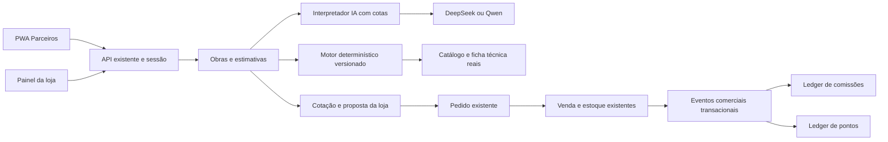

# Parceiros Profissionais — auditoria e plano para aprovação

Data: 11/10/2026. Base analisada: main, ec7ef70. Status: proposta; implementação ainda não autorizada neste novo escopo.

O documento do usuário exige: “Apresente o plano para minha aprovação antes de modificar o código.” Esta entrega registra a auditoria, decisões propostas, sequência e critérios de aceite. Não altera frontend, backend, schema, dados nem configuração da VPS. Aprovar este plano autoriza desenvolvimento incremental e publicação pela main/GitHub Actions, sem contratar serviços ou efetuar pagamentos reais.

## 1. Decisão de produto

Criar Rebequi Parceiros como uma experiência própria em `/parceiros/`, dentro da aplicação e da API existentes. Reaproveitar conta, catálogo, estoque, cotação, pedidos e vendas. O profissional continua podendo comprar como cliente; sua aprovação como parceiro habilita o programa comercial. Não criar outro cadastro de clientes, outro estoque, outro financeiro de vendas ou outro serviço de IA.

Primeira entrega útil: cadastro profissional e aprovação, obras, calculadora determinística de pintura/pisos, lista revisável e solicitação de cotação real. Em seguida, proposta da loja/aceite/pedido, indicações, extratos separados de pontos e comissões, recompensas, oportunidades, conteúdos e notificações. Aplicativos de loja são uma decisão posterior à validação do PWA.

Tarefas em três etapas referem-se a três etapas de decisão, não a uma promessa de que todos os cadastros exigirão apenas três toques. A interface mostra só os campos necessários, preserva o progresso e exige confirmação onde afeta quantidades, dados de clientes ou valores.

## 2. Auditoria da base existente

Inspeção de schema Prisma, tipos/schemas compartilhados, autenticação/permissões, rotas/controllers/services/repositories de catálogo, orçamentos, pedidos, vendas, IA e imagens; rotas React, painéis e componentes; manifesto, entrada Vite, Nginx, Compose e workflow. Consulta SSH somente de leitura limitada aos três contêineres Rebequi. Não foram consultados dados pessoais nem chaves comerciais; não houve chamada paga de IA.

| Área | Evidência na aplicação | Reutilização e lacuna |
| --- | --- | --- |
| Arquitetura | React 18/Vite/React Query, Express/TypeScript, Prisma/PostgreSQL 16, pacote shared | Manter monorepo e serviços existentes; novos módulos por domínio, sem microsserviços |
| Identidade | User, CUSTOMER e perfis internos; cookies HttpOnly; sessão consulta usuário ativo e role atual | PartnerProfile 1:1 com User. Capacidade de parceiro aprovada separada do role; não adicionar parceiro à lista de funcionários |
| Cadastro rápido | Senha provisória aleatória; primeiro ajuste dispensa senha atual apenas para conta provisória autenticada | Reutilizar. Conta com WhatsApp existente exige login; não atribuir indicação nem vincular cliente por simples conhecimento do telefone |
| CRM | CustomerStage, tags, notas e follow-up ligados a User | Reaproveitar para clientes da loja; contato privado de uma obra não cria automaticamente conta ou lead comercial |
| Catálogo | Product/Category/ProductImage, SKU, preço Float, estoque/reserva Int, peso e dimensões em texto | Faltam unidade comercial, conteúdo da embalagem, cobertura/consumo e fonte técnica estruturados. Nome “18 L” não é uma especificação verificável |
| Estoque | StockReservation, saldo disponível, bloqueios transacionais, consumo/liberação/expiração | Estimativa e cotação não reservam. Pedido aprovado usa o fluxo existente; unidade vendida inicialmente é embalagem/unidade inteira |
| Orçamentos | QuoteRequest e QuoteItem, propriedade por cliente, DRAFT/SUBMITTED/IN_REVIEW/RESPONDED/ARCHIVED, foto e edição | Lista funciona; RESPONDED hoje atualiza status, não uma proposta com preço negociado, validade, versão e aceite |
| Pedido | CustomerOrder, snapshots, checkout WhatsApp, histórico por usuário e venda vinculada | Não há vínculo quote → proposta aceita → pedido. Acrescentar relação/idempotência; manter pedidos atuais compatíveis |
| Venda | Sale/SaleItem, PAID/PENDING_PAYMENT/CANCELED, desconto, baixa/estorno atômico, idempotência | Fonte de elegibilidade comercial. Não confundir pedido concluído ou clique no WhatsApp com receita recebida |
| Financeiro | Resumo de faturamento e métodos de pagamento derivados de Sale | Não é contas a pagar nem sistema fiscal. Faltam obrigação de comissão, lote de pagamento, devolução parcial e conciliação de benefícios |
| IA | DeepSeek Flash e Qwen VL diretos, configurações AES-GCM, timeout/fila/concorrência, OCR associado localmente ao catálogo | Reaproveitar provedores/chaves/transporte; criar interpretação de serviço e telemetria de todas as tentativas, cotas persistentes e cache. Não reutilizar OcrRun com quote fictício |
| Imagens | WebP, limites, crop/compressão no navegador, Sharp limitado, storage na VPS e volume persistente | Reaproveitar transformação. Documentos em `/uploads/quotes/` têm no-store, mas o static atual não exige autorização. No-store não controla acesso; proteger documentos e fotos privadas antes de portfólios/plantas |
| UX | DashboardElements, DashboardList, wizard de orçamento, câmera fullscreen, marca/cores Rebequi | Reutilizar elementos, estados e captura. Criar layout profissional com navegação inferior; não copiar sidebar administrativa |
| PWA | site.webmanifest com standalone, ícones 192/512, maskable e apple-touch-icon | start_url atual é a loja; main.tsx não registra service worker e Vite não o gera. Não há offline, instalação orientada, push ou atualização controlada |
| Frontend | App.tsx importa páginas diretamente; um conjunto grande de rotas | Dividir módulo de parceiros por rota. Não precachear toda a loja, painel admin, câmera/OpenCV e bibliotecas raramente usadas |
| Cache/segurança | React Query limpo na troca de conta/logout; cookies e CORS; Nginx dá cache longo para .js | Service worker/manifest precisam regras próprias sem immutable. Novos endpoints financeiros exigem origem/CSRF, propriedade e permissões verificadas no servidor |
| Trabalho assíncrono | IntegrationJob com lease/retry/limpeza, processamento local de catálogo | Reutilizar padrão transacional e persistente, com handlers separados. Não anunciar sincronização remota nem colocar push como se fosse CATALOG_CHANGED |
| Operação | Workflow único: builds paralelos no GitHub, imagens GHCR, integração PostgreSQL/Chromium descartável, backup/restauração e rollback | Preservar. Migrações aditivas e implantação por etapa, sem deploy manual SSH |
| Módulos novos | Sem modelos/rotas para parceiros, obras, comissões, pontos, recompensas, conteúdos ou oportunidades | São novos domínios necessários; não presumir que telas ou saldos existentes já os representam |

Amostra de produção em repouso: API 57,55 MiB, web 6,285 MiB, PostgreSQL 38,68 MiB; CPU 0,00% no instante observado, todos saudáveis. Total aproximado 103 MiB. Isso não mede pico, concorrência, capacidade ou espaço disponível. Deploy ec7ef70 concluído com sucesso no workflow 38184121810. Medir armazenamento e carga do módulo antes de ampliar limites, sem alterar serviços compartilhados.

## 3. Arquitetura e limites de domínio

Estimativa é a necessidade técnica calculada com premissas; não promete preço nem estoque. Cotação é a proposta comercial da loja, versionada, com validade e confirmação. Mão de obra é um orçamento do profissional, com serviços/valores próprios, sem tratar esse valor como receita Rebequi ou base automática de comissão.

Backend proposto: partner, project, material-estimate, quote-proposal, referral, partner-benefit e partner-content como módulos da API. Schemas/types no shared; motor puro em shared para uso offline e servidor, com resultado comercial sempre revalidado no servidor. Fórmula e parâmetros têm versão imutável. Endpoints paginados e projeções pequenas; listas do início não carregam fotos, extratos completos e todas as obras.

Rotas: `/api/partners/me`, `/projects`, `/estimates`, `/referrals`, `/benefits`, `/content`, `/opportunities`, `/notifications`; operações da loja em `/api/partners/admin/...`. Reutilizar `/api/quotes`, `/orders`, `/sales` para suas entidades. Cliente nunca escolhe userId, status aprovado, taxa, saldo ou beneficiário final da venda no payload público.

## 4. Estrutura de dados proposta

Definição detalhada das migrações acontece após aprovação. Somente novas tabelas necessárias e relações opcionais nas existentes; sem preencher dados fictícios ou conceder benefícios históricos automaticamente.

| Entidade/extensão | Dados e invariantes |
| --- | --- |
| PartnerProfile | userId único, código aleatório único, profissão/especialidades múltiplas, cidade/região, experiência, serviços, disponibilidade, status PENDING/APPROVED/SUSPENDED/REJECTED, responsável/data/motivo; aceite da versão das regras e preferências |
| PartnerProfileAudit | ator, mudança de status/campos controlados, motivo e data; suspensão bloqueia novas indicações/benefícios e não apaga obrigações existentes |
| Project / ProjectRoom | proprietário parceiro, título, referência/localização mínima, contato opcional privado, tipo de serviço, medidas com unidade, observações, ACTIVE/ARCHIVED; versão para edição concorrente |
| ProjectAsset | storageKey, dono/projeto, dimensões/tamanho/tipo, privacidade e consentimento de publicação; portfólio público só por escolha explícita |
| ProductTechnicalSpec | productId único, unidade vendida, conteúdo/medida da embalagem, área por caixa, rendimento por demão OU acabado, consumo por aplicação, limitações, ficha/fonte/versão e validação administrativa |
| MaterialEstimate / EstimateItem | projeto, input normalizado, fórmula/versão, parâmetros/fontes, resultado bruto, perda, arredondamento, productId opcional e pendências; edição manual preserva valor calculado e motivo |
| LaborQuote / LaborQuoteItem | projeto, versão, serviços, quantidade/unidade, valor declarado pelo profissional, validade e aceite; separado de cotação da loja |
| QuoteRequest, QuoteProposal/Item | vínculo opcional com projeto/estimativa/parceiro; proposta contém snapshots de produtos, unidade, quantidades, preço, desconto, disponibilidade/pendências, validade e versão; alteração cria nova versão, não reescreve aceite |
| CustomerOrder/Sale | vínculo opcional com proposta e atribuição de indicação; restrição única evita dois pedidos da mesma proposta. Quem compra e o profissional responsável são pessoas distintas quando aplicável |
| ReferralAttribution | parceiro, cliente/pedido/orçamento, origem link/código/balcão, confirmação, validade e ator; uma atribuição comercial por pedido/venda; autoindicação rejeitada; conflito visível à loja |
| PartnerProgramRule | versão/vigência, comissão em pontos-base, base líquida elegível, exclusões, espera, limites, regras de pontos, níveis/campanhas e expiração; programa financeiro inicialmente desativado e taxa zero até configuração |
| PartnerCommission/Entry | obrigação por venda/parceiro/regra, estados PENDING/APPROVED/PAID/REVERSED/BLOCKED, base/valor Decimal, estornos compensatórios, eventKey único, snapshots e trilha de aprovação; sem deletar lançamentos |
| CommissionPayment/Allocation | registro de pagamento e alocações únicas, comprovante privado, responsável, data e confirmação; sem iniciar PIX ou transferência nesta proposta |
| PartnerPointLot/Entry | pontos inteiros, origem única, validade de lote, saldo derivado, débito/estorno/expiração identificados; não usar o saldo de comissões como pontos |
| PartnerTier / Reward / Redemption | nomes/critérios configuráveis, estoque/limite de recompensa, custo em pontos, solicitação/reserva/aprovação/entrega/cancelamento e chave idempotente |
| Opportunity/Assignment | região/especialidade, dados mínimos, consentimento, seleção registrada e expiração; contato liberado somente a profissional atribuído com autorização |
| PartnerContent / Campaign | conteúdo real, tipo/link/fonte, período, público, especialidades e imagem; conclusão de treino não é comprovada apenas por abrir vídeo |
| Notification/Subscription | caixa interna, preferências por tipo, endpoint push privado, proprietário/dispositivo, consentimento/revogação e deduplicação |
| AiUsage/AiQuota/AiCache | tarefa/provedor/modelo/versão, tokens recebidos, reserva de cota, erro sanitizado, status e preço aplicado/data quando conhecido; cache técnico sem contato/endereço e com TTL |
| Evento comercial/outbox | venda paga/cancelamento/devolução, ID/versão únicos, escrito na transação da operação; processamento repetido não duplica benefícios |

Restrições únicas, FK, índices por proprietário/status/data/expiração e transações para alterações financeiras. Montantes novos em Decimal ou centavos inteiros com arredondamento definido, nunca Float no ledger. Vendas atuais usam Float: converter a base comercial para centavos uma única vez com teste de arredondamento e snapshot; uma migração global de preços históricos não faz parte da primeira fase. Estoque atual é inteiro: quantidade técnica em L/kg/m² é convertida em embalagens inteiras antes do pedido. Venda fracionada exigiria alteração específica aprovada de estoque, fora dessa simplificação.

## 5. Experiência do profissional e da loja

Navegação inferior com cinco áreas: Início, Obras, Calcular, Benefícios, Perfil. Oportunidades e conteúdos aparecem no início com lista própria por “Ver todos”; não adicionar novas abas principais. Perfil reúne especialidades, portfólio, região, disponibilidade, senha, regras, instalação e notificações.

| Tarefa | Etapa 1 | Etapa 2 | Etapa 3 |
| --- | --- | --- | --- |
| Participar | Entrar/cadastro rápido | Profissões e região | Conferir e solicitar aprovação |
| Nova obra | Nome e serviço | Ambientes/medidas opcionais | Salvar ou calcular |
| Calcular | Serviço e medidas | Conferir parâmetros/premissas | Revisar lista e cotar |
| Pedir materiais | Lista calculada, foto ou manual | Revisar produtos/quantidades | Selecionar comprador e enviar |
| Compartilhar | Escolher estimativa/proposta/mão de obra | Conferir dados incluídos | Compartilhar arquivo/link autorizado |
| Indicar | Abrir código/link/QR | Escolher compartilhar ou vincular cotação | Conferir atribuição e situação |
| Resgatar | Escolher recompensa | Conferir pontos/condições | Confirmar solicitação |
| Loja aprovar parceiro | Pendentes | Conferir perfil | Aprovar/suspender com motivo |
| Loja pagar comissão | Selecionar obrigações elegíveis | Conferir total/documentos | Registrar pagamento realizado |

Início mostra próxima ação, cotações pendentes, obras recentes e resumos pequenos. Comissões mostram separadamente aguardando, liberadas e pagas; pontos mostram disponível e próximo vencimento. Não mostrar “R$ 0,00” como se fosse saldo consultado enquanto carrega ou falha. Cadastro pendente explica a próxima etapa em uma linha. Suspenso mantém acesso ao histórico e valores já devidos, com regras específicas para recebimento.

Componentes reutilizáveis: MobileWorkspace, BottomNavigation, StepFlow, MeasurementInput com unidade, ProductPicker, QuantityStepper, MaterialReview, FormulaSummary recolhível, QuoteSummary, LedgerList, StatusBadge, Empty/Error/Loading e ImageUpload com crop. Reaproveitar primitives existentes; evitar segunda biblioteca visual. Botões principais com área confortável de ao menos 44 px, contraste, foco/teclado, teclado numérico com vírgula decimal, leitores de tela, safe-area e nome de produto sem truncamento irreversível.

Admin acrescenta “Parceiros”: cadastro/aprovação, obras/cotações comerciais autorizadas, indicações, benefícios, conteúdos/oportunidades e regras. Perfis de catálogo validam fichas; comercial atende cotações/indicações; ADMIN/MANAGER controlam programa, com aprovação de pagamento separada e auditada. Dados privados das obras não são automaticamente visíveis a todos os funcionários; loja vê apenas os compartilhados na solicitação.

## 6. Motor técnico e calculadora

Começar por pintura e pisos/revestimentos por terem parâmetros declarados e fórmulas auditáveis. Alvenaria não estrutural e impermeabilização entram após fichas/ensaios. Carpintaria exige plano de corte, não simples volume convertido em chapas. Drywall, elétrica, hidráulica, coberturas e estruturas terão coleta guiada/lista manual enquanto faltarem regras técnicas validadas; não produzir dimensionamento de segurança por LLM.

Motor rejeita unidade incompatível, dimensões não positivas, aberturas maiores que a superfície, percentuais fora dos limites e parâmetros incompletos. Todo resultado mostra entrada, fórmula, perdas, embalagem e origem do coeficiente. Sem parâmetro técnico, pedir informação ou deixar pendente, nunca usar silenciosamente um rendimento genérico. Perda sugerida pode ser configurada por serviço, mas deve ser visível e confirmada.

| Cálculo | Regra proposta | Informação indispensável |
| --- | --- | --- |
| Área de paredes | soma de comprimento × altura − aberturas; teto calculado separadamente | Medidas reais confirmadas, unidade e superfícies selecionadas |
| Tinta por demão | litros = área × demãos / rendimento em m²/L/demão; aplicar perda e ceil(litros/volume da embalagem) | Unidade/basis do rendimento, demãos, superfície e volume |
| Tinta com rendimento acabado | embalagens = ceil(área × (1 + perda) / área acabada declarada por embalagem) | Não multiplicar novamente pelas demãos incluídas no rendimento acabado |
| Piso/revestimento | área de compra = área aplicada × (1 + perda); caixas = ceil(área de compra/área por caixa) | Conteúdo real da caixa, assentamento/recortes e perda confirmada |
| Argamassa | kg = área aplicada × consumo kg/m² para peça/substrato/método selecionados; sacos = ceil(kg ajustados/kg por saco) | Ficha do SKU compatível com tamanho de peça e aplicação; não adicionar perda do piso automaticamente ao consumo de argamassa |
| Rejunte | usar consumo/tabela do fabricante para dimensões, espessura, junta e densidade quando fornecida | Sem tabela ou coeficientes validados, manter em cotação pendente; não inferir densidade pelo nome |
| Alvenaria não estrutural | unidades = ceil(área líquida/área modular do bloco com juntas × (1 + perda)) | Posição/tipo/dimensões do bloco e junta; não estima resistência, fundação ou armadura |
| Impermeabilização | área × consumo total do sistema OU por demão explicitamente identificado; converter em embalagens | Sistema/produto, base do consumo, preparação e número de demãos validados |

Referências iniciais: [Suvinil — cálculo de tinta](https://www.suvinil.com.br/blog/como-calcular-tinta) distingue rendimento acabado; [Quartzolit — boletim de argamassa](https://www.quartzolit.weber/files/br/2017-06/BT_porcelanato_e_piso_sobre_piso_externo_quartzolit.pdf) demonstra consumo dependente da dimensão da peça e aplicação. Cada ficha deve corresponder ao produto efetivamente vendido, ter data/versão e aprovação técnica; esses exemplos não tornam um coeficiente universal. Sem acesso às normas técnicas aplicáveis, não alegar conformidade ABNT por extrapolação desses textos.

Associação ao catálogo: ID confirmado ou busca local por categoria/ficha/unidade e compatibilidade. Similaridade de nome gera sugestão, não escolha automática de produto incompatível. Sem SKU válido, mostrar “Pendente de cotação”, sem preço ou estoque inventados. Estimativa de custo usa somente produtos associados e preço real na consulta; total parcial identificado quando houver pendências. Substituição recalcula embalagem/rendimento e compara premissas.

Casos de aceite incluem unidades cm/m, áreas líquidas, vírgula decimal, perda zero, quantidade exata de embalagens, arredondamento para cima, tinta acabada sem demãos duplicadas e alteração de produto que muda consumo. Fotos/croquis não geram escala ou área sem uma medida confirmada. Todo serviço de segurança pede validação por profissional habilitado antes de uso da lista; não converter a confirmação em certificação automática.

## 7. IA, custo e tolerância a falhas

Reutilizar chaves e provedores oficiais existentes; criar interface de tarefas `interpretService`, `suggestComplements` e `explainProduct`, distinta de reconhecimento de foto. Principal proposto: DeepSeek Flash sem pensamento; Qwen Flash de texto como alternativa econômica. Qwen VL continua para imagens. Não trocar o modelo do OCR que funciona como efeito colateral da nova calculadora. Outros modelos chineses podem ser adicionados após benchmark/custo/retenção/acesso à API; não contratar um terceiro provedor nesta etapa.

IA entrega JSON tipado com atividade, medidas/unidades declaradas, campos ausentes e sugestões referenciadas. Motor calcula; o profissional confirma os campos extraídos. Perguntas técnicas recuperam poucos produtos/fichas reais e suas fontes; não enviar catálogo inteiro ou histórico de clientes. Texto da foto/ficha é dado, nunca instrução para executar ferramentas. IA não grava preço, taxa, saldo, pagamento ou reserva.

Limites propostos iniciais configuráveis: descrição até 4.000 caracteres, contexto selecionado até 6.000 tokens de entrada estimados, saída até 1.000 tokens, 20 s por chamada, uma reserva opcional e explícita, até 20 interpretações por parceiro/dia e teto mensal global definido pelo admin. Fórmulas e modo manual não consomem tokens. Cota é reservada atomicamente antes da chamada para evitar concorrência/abuso; sem estimativa confiável de custo ou quota esgotada, bloquear IA e preservar fluxo manual.

Registrar toda tentativa, inclusive falhas/fallbacks, duração, modelo, tokens informados e status de consumo desconhecido quando timeout não devolve uso. Não dar custo zero a timeout; separar estimativa de cobrança e fatura real do fornecedor. Cache local por hash de entrada técnica normalizada, modelo/prompt/fórmula/ficha, TTL e limite de tamanho; sem nomes, contatos ou endereços. Mudança de fórmula ou ficha invalida cache. Endpoint JSON validado, timeout, resposta limitada, segredo cifrado e chave nunca no navegador. Testes pagos reais só com autorização de custo específica.

Estimativa de operação textual em 11/10/2026, sem cache/fallback/imagem/impostos: 2.000 tokens entrada + 700 saída. DeepSeek Flash custa cerca de US$ 0,00072 fora de pico ou US$ 0,00144 em pico por interpretação; 10.000 ≈ US$ 7,20–14,40. Qwen Flash internacional/Singapura na faixa até 256K: cerca de US$ 0,00038; 10.000 ≈ US$ 3,80. Fórmula: (entrada × tarifa entrada + saída × tarifa saída) / 1.000.000. Tarifas e modelos/regiões mudam; são orçamento, não compromisso de despesa. [DeepSeek oficial](https://api-docs.deepseek.com/quick_start/pricing/), [Alibaba oficial](https://www.alibabacloud.com/help/en/model-studio/model-pricing).

Aceite: benchmark autorizado com serviços conhecidos, sem PII, mesma lista de casos/resultado técnico, métricas de campos extraídos/campos ausentes/custo/latência; o acerto matemático é testado independentemente do LLM. Teste de conexão ou modelo listado não comprova qualidade, saldo utilizável ou suporte a todos os prompts.

## 8. Indicações, pontos e comissões

Código aleatório compartilhável com link e QR gerado localmente, sem API externa. URL não contém cliente/telefone. Link registra intenção, não beneficia uma venda automaticamente; associação deve ser confirmada pelo comprador ou operador durante orçamento/checkout/balcão. Proposta: vínculo por pedido, com janela configurável; acesso a um link posterior não sobrescreve a atribuição confirmada. Atendimento presencial registra código e consentimento no pedido/venda. Conflitos e correções exigem operador, motivo e audit trail.

Rejeitar autoindicação pelo mesmo User, duplicidade por pedido/venda, parceiros não elegíveis e código inválido. Telefone verificado e análise manual de suspeitas podem fortalecer prevenção; cadastro rápido por si só não verifica posse do número. Compras do próprio parceiro podem gerar pontos se a regra permitir, mas não comissão de indicação. Resumo ao parceiro não revela dados pessoais completos do comprador.

Comissão proposta sobre itens elegíveis líquidos do desconto, rateado em centavos de forma determinística, excluindo mão de obra, frete ou tributos não elegíveis quando definidos pela regra. Sale PAID cria obrigação PENDING; espera/configuração e revisão liberam APPROVED; operador registra pagamento real e comprovante para PAID. Cancelamento/retorno estorna base e obrigação; comissão já paga cria ajuste/recuperação para conferência, não débito bancário automático. Mudança de regra só vale prospectivamente, mantendo snapshot da regra de cada venda.

A base não tem devolução parcial persistente: implementar registro de devolução/ajuste comercial idempotente integrado ao estoque e benefícios antes de liberar pagamentos do programa. Não fingir que cancelar toda a venda cobre uma devolução parcial. Não reprocessar automaticamente compras antigas; eventual migração de benefícios exige escopo específico.

Pontos: crédito por evento elegível; lotes com validade; débito usa lotes de vencimento mais próximo; solicitação de resgate reserva pontos/recompensa atomicamente; reprovação/cancelamento libera uma única vez. Expiração e estorno geram lançamentos, não alteração silenciosa de saldo. Se houver benefício já consumido em venda devolvida, guardar ajuste e bloquear novo resgate conforme regra, sem ocultar dívida ou criar saldo negativo inexplicado. Níveis/campanhas podem ser configurados; não ativar Bronze/Ouro com critérios inventados.

Conciliação deve comparar eventos/vendas com obrigações, pontos, estornos e pagamentos. Worker com lease e idempotência; evento gravado junto da venda, não callback pós-commit sujeito a perda. Duas confirmações/retries simultâneos têm efeito único. Novos lançamentos auditados não usam a limpeza de 30 dias dos jobs como prazo de retenção financeira.

## 9. PWA, offline e distribuição nativa

Manifesto específico Rebequi Parceiros com id estável, start_url `/parceiros/`, scope correspondente, standalone, ícones atuais fiéis à marca e versão maskable; manifesto da loja preservado. Splash no Android derivado de manifesto; no iOS reaproveitar apple-touch-icon e validar inicialização em aparelhos reais, sem presumir equivalência de todas as versões. HTTPS e origem canônica para sessão/instalação.

Service worker próprio do caminho de parceiros usando Workbox injectManifest no build GitHub. Assets versionados de shell/formulários/motor calculador; carregamento por rota e importação tardia da câmera. `/api/`, cookies, callbacks OAuth, documentos de clientes, extratos e preços não entram no cache automático. Imagens públicas podem ter cache limitado; fotos privadas não. `sw.js`/manifest sem immutable, atualização verificável pelo navegador; limpeza apenas dos caches Rebequi Parceiros conhecidos.

Offline inicial: abrir shell e calculadora após primeira visita, medidas/lista técnica sem PII, indicador “Salvo neste aparelho” e envio explícito ao reconectar. Rascunho persistente opcional por conta com limite/TTL e limpeza no logout/troca de conta; armazenar o mínimo, sem fotos/clientes/preços por padrão. API continua exigindo sessão online. Não mostrar “Enviado” quando só foi salvo localmente. Sem Background Sync como requisito para iOS; reconciliação em primeiro plano, idempotencyKey e controle de versão, com revisão de conflito e confirmação após mudança de preço/estoque.

Instalação Android quando evento/prompt suportado e instrução manual alternativa; iOS com orientação “Compartilhar → Adicionar à Tela de Início”. Atualização avisa o usuário, salva rascunho antes de recarregar e não aciona skipWaiting durante captura/envio/edição. Detectar armazenamento indisponível/expulso e oferecer retomada online.

Push: opt-in por ação do usuário, VAPID, subscriptions por usuário/dispositivo, fila persistente limitada e remoção de endpoint expirado. Validar endpoints contra abuso de SSRF, aceitar somente provedores suportados, sem redirecionamento para hosts arbitrários. Mensagem genérica e link protegido, sem valor/contato privado na tela bloqueada. Preferências por conteúdo/oportunidades/transações; revogar em logout quando necessário para aparelho compartilhado. Caixa interna é alternativa quando navegador/OS não oferece push. No iOS/iPadOS, Web Push depende de web app adicionado à tela inicial e suporte da versão; [WebKit](https://webkit.org/blog/13878/web-push-for-web-apps-on-ios-and-ipados/).

| Opção | Adequação à base | Decisão proposta |
| --- | --- | --- |
| PWA | Reutiliza frontend/API, implantação atual, sem cadastro pago nas lojas | Implementar primeiro e validar com profissionais |
| Capacitor | Reaproveita React/web com APIs nativas e projetos Android/iOS | Candidato principal se apps forem aprovados; câmera, arquivos/share, push e offline com integração nativa real |
| React Native + Expo | Reaproveita TS/tipos/motor/API; interface web atual precisaria ser refeita | Alternativa se recursos/desempenho nativos justificarem segunda interface; EAS opcional, não obrigatório |
| Flutter | API reutilizada; linguagem/UI e ferramentas adicionais | Menor reaproveitamento nesta base; não recomendado como primeira migração |
| TWA Android | PWA verificado por Digital Asset Links, usa navegador do aparelho | Alternativa Android; não resolve iOS e não elimina requisitos da Play Store |

Documentações: [PWA/service workers](https://web.dev/learn/pwa/service-workers), [instalação](https://web.dev/learn/pwa/installation), [Workbox](https://developer.chrome.com/docs/workbox/modules/workbox-build), [Capacitor](https://capacitorjs.com/docs), [React Native](https://reactnative.dev/docs/getting-started), [Expo](https://docs.expo.dev/), [Flutter](https://docs.flutter.dev/), [TWA](https://developer.android.com/develop/ui/views/layout/webapps/trusted-web-activities).

Nativo não está incluído na autorização proposta para PWA. Exige contas da empresa, assinatura, builds Android/Xcode, revisão de privacidade/permissões, exclusão de conta, política e formulário Data Safety/Privacy, testes reais e material de publicação. Em 11/10/2026, [Google Play](https://support.google.com/googleplay/android-developer/answer/11926878?hl=en) exige API 36 para novas submissões/updates Android gerais; reconferir na data de submissão. [Apple](https://developer.apple.com/app-store/review/guidelines/) exige funcionalidade suficiente: embalagem WebView sem valor próprio tem risco de rejeição. Aprovação em loja não pode ser garantida por teste local.

## 10. Privacidade, documentos e operação comercial

Proteção por proprietário/atribuição em toda consulta e download. Remover documentos privados do static público usando rota de mídia autenticada, validando QuoteRequest/projeto/comprovante relacionado; preservar URLs públicas de produtos/promoções. Compartilhamento público de portfólio exige autorização; compartilhamento de orçamento prefere arquivo gerado após revisão ou token opaco de leitura, expiração/revogação, escopo mínimo e escolha explícita de incluir contato. Link compartilhável nunca permite editar, cotar com IA ou aceitar pedido sem autenticação.

Dados de cliente da obra permanecem privados ao profissional até compartilhar na cotação/oportunidade. Exigir autorização do cliente para distribuir contato a profissionais; distribuir por especialidade/região/disponibilidade com critério registrado e possibilidade de revisão. Notificação informa oportunidade, não expõe endereço completo a toda a base.

IA recebe somente descrição técnica saneada, sem nome/telefone/endereço por padrão. Caso documento com PII precise sair do Brasil, avaliar finalidade, base legal, contratos/subprocessadores, retenção e mecanismo de transferência; usar API chinesa não dispensa LGPD. Referência: [ANPD — transferência internacional](https://www.gov.br/anpd/pt-br/assuntos/assuntos-internacionais/transferencia-internacional-de-dados). Consentimento de marketing é separado do acesso às ferramentas. Pedido de exclusão/exportação deve preservar registros sujeitos a obrigação de retenção e anonimizar quando cabível, sem prometer apagar histórico financeiro obrigatório.

Antes de habilitar desembolso, a loja define contrato/regulamento, base e prazo de comissão, devoluções, limites, elegibilidade e documentação PF/PJ. Tratamento fiscal/retenções depende da natureza contratual e do beneficiário; não fixar uma alíquota universal ou tratar recibo upload como documento fiscal válido automaticamente. Financeiro deverá configurar controles após validação contábil/jurídica, usando referências como o [Manual do IRRF da Receita](https://www.gov.br/receitafederal/pt-br/centrais-de-conteudo/publicacoes/manuais/irrf). Isso não bloqueia desenvolvimento dos formulários/ledger; bloqueia somente o pagamento sem regras aprovadas.

Segurança: sessão/cookie existente, propriedade em backend, permissão financeira distinta, confirmação adicional para pagamento, controle de origem/CSRF nas mutações, limites por usuário além do IP, trilha sem chaves/PII desnecessária, upload validado por conteúdo e proteção contra SSRF. Não assumir que aprovação de perfil verifica habilitação técnica, CPF ou propriedade do telefone. Não exigir documentos sensíveis para simplesmente usar a calculadora.

## 11. Etapas de implementação e aceite

| Etapa | Entrega e dependências | Critérios de aceite |
| --- | --- | --- |
| 0 — Fundação | Mídia privada, schemas/ownership/permissões, perfil profissional e aprovação, migrações aditivas | Conta única; CUSTOMER sem permissão admin; aprovação/suspensão no servidor; troca de conta não expõe cache; download privado 401/403 conforme acesso; regressões atuais passam |
| 1 — PWA e obras | Layout próprio, cinco áreas, obras/ambientes/portfólio, manifesto/SW, instalação/offline limitado | Instalação e navegação standalone Android/iOS reais; 320/390/768/1440 sem overflow; criar/retomar obra; negar câmera permite upload/manual; atualização preserva rascunho; logout limpa dados locais |
| 2 — Calculadora e catálogo técnico | Ficha de produto, motor pintura/pisos, entrada guiada, revisão, lista vinculada e cotação manual existente | Fórmulas verificadas; falta de ficha não gera número fictício; embalagens/unidades coerentes; custo parcial explícito; criar/reabrir cotação/projeto real sem duplicidade |
| 3 — IA e proposta | Adaptador de interpretação/explicação, cotas/cache/usage, proposta versionada da loja, mão de obra separada, aceite/compartilhamento/pedido | Benchmark remoto autorizado; indisponibilidade/limite mantém manual; aceitar proposta vencida/alterada é recusado; um pedido por aceite; estoque/preço revalidados; cliente identificado e profissional distinto preservado |
| 4 — Programa comercial | Código/link/QR, atribuição em balcão/checkout/cotação, regras, eventos, devolução/estorno, ledger de pontos/comissões | Autoindicação/duplicidade bloqueadas; evento pago gera efeito único; pendente não vira pago; cancelamento e devolução parcial conciliados; nenhum crédito retroativo automático |
| 5 — Benefícios e financeiro | Níveis/campanhas, recompensas/resgates/expiração, aprovação e registro de pagamentos/comprovantes | Resgate concorrente não gasta saldo/recompensa duas vezes; expiração idempotente; valores Decimal/centavos; divisão/estorno e pagamento auditáveis; contabilização não executa transferência bancária |
| 6 — Relacionamento | Conteúdos reais gerenciáveis, oportunidades com consentimento/critério de distribuição, preferências, caixa interna e push | Segmentação correta; revogação observada; usuário só vê oportunidade atribuída; push sem PII; endpoint inválido tratado; nenhuma entrega presumida como lida |
| 7 — Piloto e evolução | Teste com profissionais/aparelhos, medição de uso/custo, ajustes; outras calculadoras com fontes aprovadas | Jornadas completas, relatórios de conciliação, orçamento de tokens e carga comprovados; recursos sem dados ficam vazios honestamente |
| 8 — Nativo, opcional | Decisão separada após PWA; Capacitor ou opção justificada | Autorização de contas/custos/escopo, plugins úteis, builds assinados, permissões/privacidade, testes reais e submissão; resultado sujeito às lojas |

Ordem prioritária: segurança e conta → obra/calculadora/cotação útil → proposta e conversão → elegibilidade e devoluções → benefícios/pagamentos → relacionamento. Todas as fases mantêm funções existentes e usam dados reais persistidos. Regras comerciais não definidas aparecem como “Programa ainda não ativado”, sem taxas ou recompensas de demonstração em produção.

## 12. Validação, publicação e recursos

Testes unitários das fórmulas, unidades, dinheiro/rateio, prazo e políticas; integração PostgreSQL descartável para ownership, transações, concorrência, rollback e idempotência; Playwright para cadastro/obra/cálculo/cotação/aceite/pedido/indicação e admin. Testar fluxo comercial completo e evento duplicado/fora de ordem, falha depois do commit, cancelamento e devolução. Testes usam fixtures apenas no runner isolado, não como dados do produto.

PWA: verificar manifesto/scope, SW real em build de produção, não-cache de APIs/privados, offline/reconexão, dois usuários no mesmo aparelho, atualização enquanto formulário/câmera estão ativos e rollback de release. Emulação desktop não comprova câmera/install/push iOS; exigir aparelho Android e iPhone no piloto. Falta de aparelho deve ser relatada como validação pendente, não “garantido”.

IA: contrato e falhas testados sem custo em CI; teste real com teto autorizado por rodada, sem PII e com telemetria. Pagamentos e atribuições reais não são criados para testar produção. Deploy: main, commit/push por incremento, workflow único, builds paralelos GitHub/GHCR, migração aditiva, testes/backup/rollback. Novos módulos por configuração permitem manter programa financeiro desativado enquanto ferramentas entram em uso.

Sem novo contêiner residente, Redis, inferência local ou SaaS de imagens no início. Worker existente recebe handlers pequenos; cálculo CPU leve; fotos WebP no volume Rebequi com quota, backup e limpeza apenas de órfãos comprovados. Meta inicial de cache técnico local limitada a 5 MiB por conta e fotos de portfólio até 8 por parceiro/250 KiB alvo, sujeitos à compressão real. 500 parceiros × 8 × 250 KiB ≈ 0,95 GiB de imagens, antes de projetos/backups; limite de disco deve ser medido antes de ativar upload em escala. Não prometer que a VPS atual absorve qualquer volume.

Custos incrementais previstos: PWA usa VPS/GitHub existentes, sem assinatura nova obrigatória; IA variável conforme uso acima; backups/disco podem exigir capacidade adicional após medição. Web Push com VAPID não exige serviço pago de envio na arquitetura proposta, mas depende das plataformas dos navegadores e de conectividade. Native opcional: [Play Console US$ 25 uma vez](https://support.google.com/googleplay/android-developer/answer/6112435?hl=en), [Apple Developer US$ 99/ano](https://developer.apple.com/programs), além de hardware/build/distribuição e impostos locais. Não criar contas nem contratar esses itens sem autorização específica.

Indicadores do piloto: conclusão de cadastro/aprovação, tempo até primeira lista/cotação, abandono por etapa, correções de medidas/materiais, lista→cotação→proposta→pedido→venda, uso/custo de IA, taxa de erro e latência, retomada offline, referências atribuídas, saldos conciliados e retorno de parceiros. Adotar metas quantitativas de carga/latência após amostra equivalente; não inventar resultado antes de medir.

## 13. Aprovação solicitada

Aprovar etapas 0 a 7 como implementação incremental da plataforma PWA integrada descrita, incluindo as extensões mínimas de orçamento/venda/privacidade necessárias. Etapa 8 (apps de loja), contratação, chamadas pagas de teste, pagamentos bancários, crédito retroativo e mudanças destrutivas continuam sujeitos a autorização específica. A implementação técnica avança sem exigir todas as regras comerciais/chaves/aparelhos previamente; somente a ativação ou validação dependente aguarda esses dados.

Próxima ação após aprovação: implementar fundação de acesso/mídia e cadastro de parceiros com aprovação, testes e publicação pela main; depois obras e primeira jornada útil de cálculo/cotação. Nenhuma alteração de código dessa plataforma foi feita nesta auditoria.
